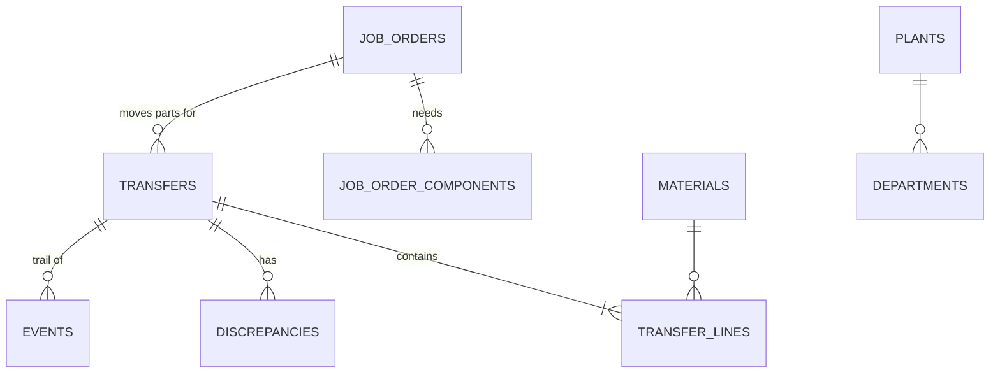
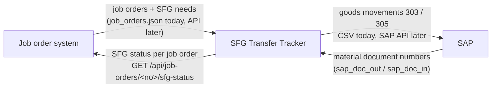

# SFG Transfer Tracker

A working prototype that tracks semi-finished goods (SFGs) moving between Indus International's three plants, from the moment one plant sends a part to the moment another confirms it arrived. Every step is written to an append-only trail that can't be edited, so when a plant says "we never got it", there is a record to check.

**Live demo:** _link added after deploy_ (free hosting: the first load can take about 30 seconds while it wakes up, and demo data resets when it restarts)

**Design note (1 page):** [NOTE.md](NOTE.md)

## Run it locally (one command)

Needs Python 3.10 or newer. On macOS or Linux:

```bash
./run.sh
```

Then open http://127.0.0.1:5050. The first run creates a virtual environment and installs Flask (about 20 seconds). Data is saved in `instance/sfg_tracker.db` and survives restarts.

- `./run.sh reset` rebuilds the database with fresh demo data
- `./run.sh test` runs the 11 automated checks

On Windows: `python -m venv .venv`, `.venv\Scripts\pip install -r requirements.txt`, `.venv\Scripts\python app.py`.

## Two-minute demo

1. **Dashboard.** The demo data has 5 transfers: one clean, one with a short and damaged receipt, one sent 9 hours ago and never received (overdue and flagged), and two in transit now.
2. **Send parts.** Pick job order `JO-2026-1042`, from plant `1200`, add `SFG-SM-2001` x 24, your name, and click *Log as sent*. You get a transfer number and a printable slip with a QR code that opens the receive screen.
3. **Receive parts.** Open the transfer and click *Receive*. The sent quantity is hidden on purpose (a blind count). Enter 22. The tracker records a 2-piece shortage as a discrepancy, and both plants see it on the dashboard until someone records how it was settled.
4. **Trail.** Every action is there in order, with who, when and which plant. The page re-checks the hash chain each time it loads.
5. **Job orders.** For each job order, see how many of each SFG are required, in transit, received good at the assembly plant and still missing. This is what the job order system would get back.
6. **Integration.** How the tracker talks to the job order system and to SAP, with the endpoints and field mapping.

## What it handles

| Situation | What happens |
|---|---|
| Plant sends parts | Transfer logged against a job order, lines checked against that job order's bill of materials, slip printed |
| Plant receives parts | Blind count per line; only the destination plant can receive; a transfer can only be received once |
| Fewer, more or damaged parts arrive | Discrepancy raised automatically (short, excess, damaged) and stays open until settled with a note |
| Parts never arrive | In transit longer than 4 hours (set by `TRANSIT_SLA_HOURS`) shows as overdue; either plant can flag "not received"; a late receipt closes the flag |
| Someone edits the record | The database blocks edits and deletes on the trail, and a hash chain shows if a row was changed outside the app |

## How it's built

- **Python + Flask + SQLite.** Server-rendered pages, no build step, one file of data.
- **`tracker/core.py`** holds every business rule. The web pages and the JSON API both call it, so there is one set of rules. Each change and its trail event are written in one transaction.
- **`tracker/schema.sql`** is the data model: plants, departments, materials, job orders (read-only copy), transfers, transfer lines, discrepancies and the events table.
- **`data/job_orders.json`** is the dummy job order file: a stand-in export from the existing job order system, with each job order's SFG requirements.
- **`data/master_data.json`** holds the dummy plants, departments and SFG materials (headers, distributors, end plates, casing channels, drain pans).

### Data model



### Integration boundary



| Endpoint | Purpose |
|---|---|
| `GET /api/transfers` | Transfers with lines and discrepancies; filter by `status`, `job_order_no`, `from_plant`, `to_plant` |
| `POST /api/transfers` | Log a send (same rules as the form), for a scanner app or another system |
| `POST /api/transfers/<no>/receive` | Confirm receipt; `409` if already received or wrong plant |
| `GET /api/job-orders/<no>/sfg-status` | Required, sent, in transit, received good and missing per SFG |
| `GET /api/events?after_id=N` | The trail as a feed; a consumer keeps the last id it read |
| `GET /api/trail/verify` | Re-checks the hash chain |
| `GET /export/sap-goods-movements.csv` | Every send (303) and receipt (305) as an SAP-style goods movement line |

Example:

```bash
curl -X POST http://127.0.0.1:5050/api/transfers -H 'Content-Type: application/json' -d '{
  "job_order_no": "JO-2026-1043", "from_plant": "1100", "from_dept": "HDR", "to_plant": "1300",
  "sent_by": "API test", "lines": [{"material_no": "SFG-HDR-1001", "qty": 6, "batch": "H261114-20"}]}'
```

### SAP mapping

Plant codes, material numbers, batch and unit of measure follow SAP's shape. A send maps to movement type 303 (out of the issuing plant into stock in transit) and a receipt to 305 (into stock at the receiving plant), SAP's standard two-step plant-to-plant transfer. A shortage stays in transit until found or written off. The export columns follow SAP's goods movement item fields. If Indus moves stock with stock transport orders instead, only the export mapping changes. All of this is to be confirmed with the SAP team.

## Known limits

- No login: people type their name. Production would use plant logins or badge scans.
- The free hosted demo has temporary storage and reloads the demo data when it restarts.
- SQLite is fine for a pilot at one site; a live rollout across three plants would move to Postgres without changing the business rules.
- No returns or partial-receipt flow yet; a mismatch is recorded and settled with a note.

## Project layout

```
app.py                 web pages + JSON API
tracker/core.py        business rules and the trail
tracker/schema.sql     data model
tracker/seed.py        builds the demo database
data/                  dummy job order file and master data
templates/, static/    UI
tests/test_flow.py     11 end-to-end checks
run.sh                 one-command start
render.yaml            free hosted demo config
```
