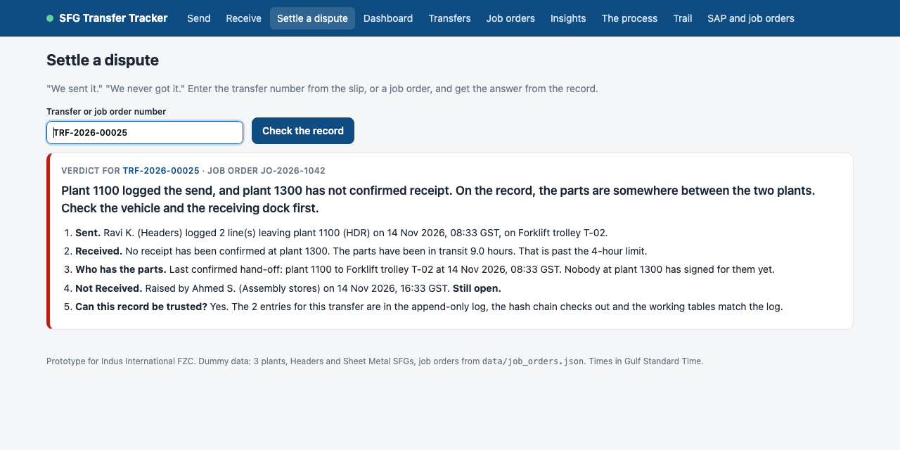
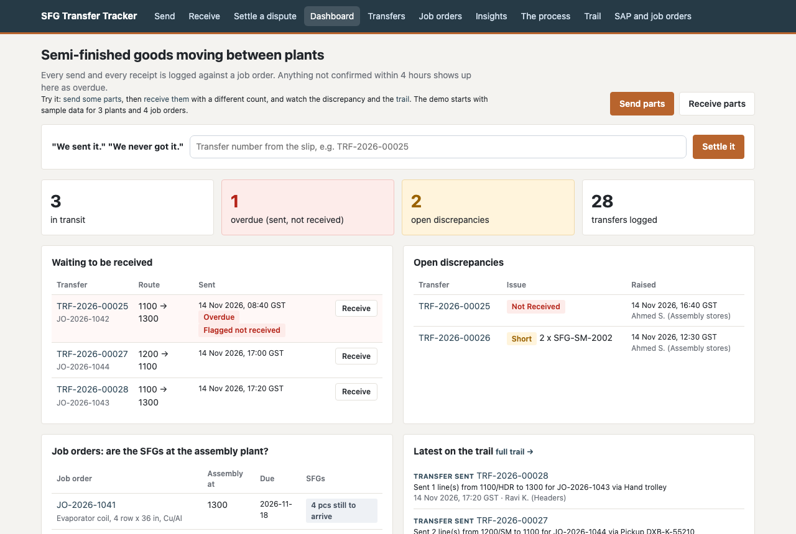
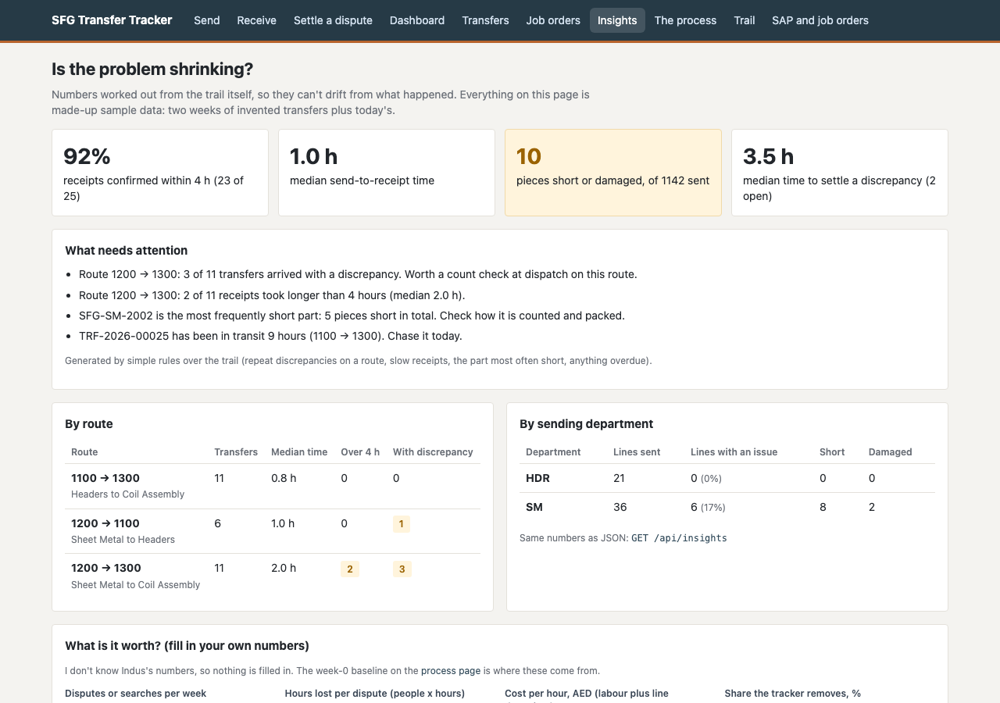
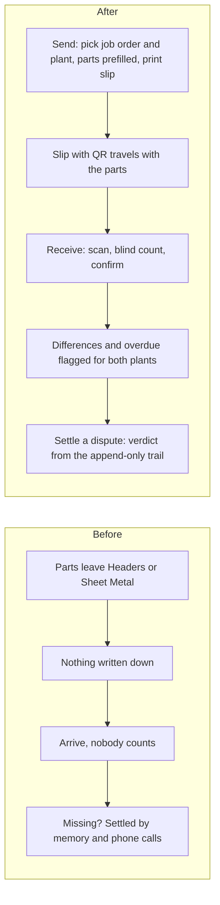
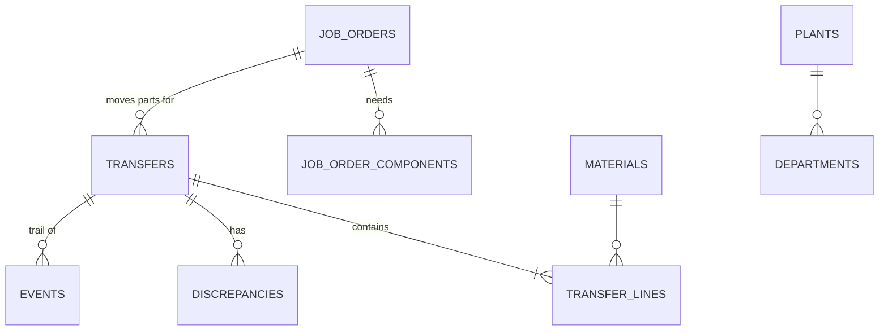
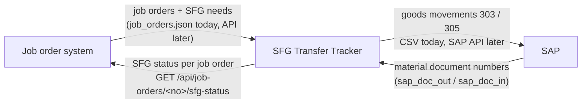

# SFG Transfer Tracker

A working prototype that tracks semi-finished goods (SFGs) moving between Indus International's three plants, from the moment one plant sends a part to the moment another confirms it arrived. Every step is written to an append-only trail (the database rejects edits and deletes), so when a plant says "we never got it", there is a record to check.

I'm Nilay Toshniwal, final-year at BITS Pilani Goa; this is my 5-hour assignment. I put most of the design effort into the dispute case, since that is the pain the brief describes.

**Live demo:** https://mastaadmi.pythonanywhere.com (sample data: 3 plants, 4 open job orders and two weeks of past transfers; anything you send or receive there is saved)

**Design note (1 page):** [NOTE.md](NOTE.md)

| Settle a dispute | Dashboard | Insights |
|---|---|---|
|  |  |  |

## The process it supports



The app's *The process* page has the same before and after, the pilot plan (one route, baseline first) and where AI fits and where it doesn't.

## Run it locally (one command)

Needs Python 3.10 or newer. On macOS or Linux:

```bash
./run.sh
```

Then open http://127.0.0.1:5050. The first run creates a virtual environment and installs Flask (about 20 seconds). Data is saved in `instance/sfg_tracker.db` and survives restarts.

- `./run.sh reset` rebuilds the database with fresh demo data
- `./run.sh test` runs the 24 automated checks

On Windows: `python -m venv .venv`, `.venv\Scripts\pip install -r requirements.txt`, `.venv\Scripts\python app.py`.

## Three-minute demo

1. **Settle a dispute.** On the dashboard, type `TRF-2026-00025` (sent hours ago, never received, flagged by Plant 3). The verdict says who sent what, that nobody has signed for it, who last had the parts, and whether the record is intact.
2. **Send.** Pick job order `JO-2026-1041` and plant `1200`. The parts the plant still owes are prefilled (here, the 2 dented end plates and 2 short side channels from an earlier trip); the destination is set by the job order. Click *Log as sent* and print the slip: it has a QR code and no quantities.
3. **Receive.** Open the transfer and click *Receive*. The sent quantity is hidden (a blind count). Enter one less than you sent: the shortage becomes a discrepancy both plants see until someone records how it was settled.
4. **Insights.** Two weeks of history: % received within 4 hours, median transit time per route, discrepancy rate per department, time to settle, and plain flags such as which route keeps arriving with discrepancies. A blank-input calculator turns your own numbers into a yearly figure.
5. **Trail.** Every action in order. The page re-checks the hash chain and replays the log against the working tables on every load.
6. **Job orders and SAP.** Per job order: required, in transit, received and still missing (what the job order system gets back). *SAP and job orders* shows the endpoints, the 303/305 mapping and the goods-movement export.

## What it handles

| Situation | What happens |
|---|---|
| Plant sends parts | Transfer logged against a job order, lines checked against that job order's bill of materials, slip printed |
| Plant receives parts | Blind count per line; only the destination plant can receive; a transfer can only be received once |
| Fewer, more or damaged parts arrive | Discrepancy raised automatically (short, excess, damaged) and stays open until settled with a note |
| Parts never arrive | In transit longer than 4 hours (set by `TRANSIT_SLA_HOURS`) shows as overdue; either plant can flag "not received"; a late receipt closes the flag |
| Someone edits the record | The database blocks edits and deletes on the trail; a hash chain and a replay of the trail against the working tables flag changes made outside the app |
| Two plants disagree | *Settle a dispute* gives a plain verdict for any transfer, from the trail |
| "Where did this batch go?" | *Trace* follows a transfer, batch, part or job order back through the trail as one timeline |
| Someone rebuilds the whole record | The trail page shows a short fingerprint to send outside the system each shift; pasting an old one back proves nothing before it was rewritten |
| The sender got it as a message | Paste "JO-2026-1042: 24 end plates and 12 drain pans, pickup DXB-K-55210" on Send and the form fills itself, for a person to check |
| End of shift | *Shift digest* writes the summary (overdue, open, fingerprint) to copy or share on WhatsApp |
| "What is at each plant?" | *Directory* has a page per plant (in, out, overdue, open issues) and per part |
| Is it getting better? | *Insights* tracks receipts on time, transit time, discrepancy rate and time to settle |

## How it's built

- **Python + Flask + SQLite.** Server-rendered pages, no build step, one file of data.
- **`tracker/core.py`** holds every business rule. The web pages and the JSON API both call it, so there is one set of rules. Each change and its trail event are written in one transaction.
- **`tracker/schema.sql`** is the data model: plants, departments, materials, job orders (read-only copy), transfers, transfer lines, discrepancies and the events table.
- **`data/job_orders.json`** is the dummy job order file: a stand-in export from the existing job order system, with each job order's SFG requirements.
- **`data/master_data.json`** holds the dummy plants, departments and SFG materials (headers, distributors, end plates, casing channels, drain pans).

### Data model



### Integration boundary



| Endpoint | Purpose |
|---|---|
| `GET /api/transfers` | Transfers with lines and discrepancies; filter by `status`, `job_order_no`, `from_plant`, `to_plant` |
| `POST /api/transfers` | Log a send (same rules as the form), for a scanner app or another system |
| `POST /api/transfers/<no>/receive` | Confirm receipt; `409` if already received or wrong plant |
| `GET /api/job-orders/<no>/sfg-status` | Required, sent, in transit, received good and missing per SFG |
| `GET /api/events?after_id=N` | The trail as a feed; a consumer keeps the last id it read |
| `GET /api/trail/verify` | Re-checks the hash chain and replays the trail against the tables |
| `GET /api/transfers/<no>/verdict` | The *Settle a dispute* verdict for one transfer |
| `GET /api/insights` | The metrics behind the Insights page |
| `GET /export/sap-goods-movements.csv` | Every send (303) and receipt (305) as an SAP-style goods movement line |

Example:

```bash
curl -X POST http://127.0.0.1:5050/api/transfers -H 'Content-Type: application/json' -d '{
  "job_order_no": "JO-2026-1043", "from_plant": "1100", "from_dept": "HDR", "to_plant": "1300",
  "sent_by": "API test", "lines": [{"material_no": "SFG-HDR-1001", "qty": 6, "batch": "H261114-20"}]}'
```

### SAP mapping

Plant codes, material numbers, batch and unit of measure follow SAP's shape. A send maps to movement type 303 (out of the issuing plant, booked as stock in transfer at the receiving plant) and a receipt to 305 (from stock in transfer into unrestricted stock at the receiving plant). That is SAP's two-step plant-to-plant transfer; a one-step transfer (301) also exists. A shortage stays in stock in transfer until the rest is posted or the SAP team corrects it. The export columns follow the header and item fields of SAP's goods movement BAPI (BAPI_GOODSMVT_CREATE); storage location is left blank for the SAP team to supply. If Indus uses stock transport orders instead, postings become 351 (or 641) then 101 against the order number, so the tracker would also store that number. All of this is to be confirmed with the SAP team.

## Known limits

- No login: people type their name. Production would use plant logins or badge scans.
- The live demo is a free PythonAnywhere site with one SQLite file on disk; it needs a monthly click to stay up.
- SQLite is fine for a pilot at one site; a live rollout across three plants would move to Postgres, which changes the database layer, not the business rules.
- No returns or partial-receipt flow yet; a mismatch is recorded and settled with a note.

## Project layout

```
app.py                 web pages + JSON API
tracker/core.py        business rules and the trail
tracker/schema.sql     data model
tracker/seed.py        builds the demo database
data/                  dummy job order file and master data
templates/, static/    UI
tests/test_flow.py     24 end-to-end checks
run.sh                 one-command start
render.yaml            config for an alternative host (Render); the live demo runs on PythonAnywhere
```
